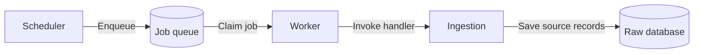
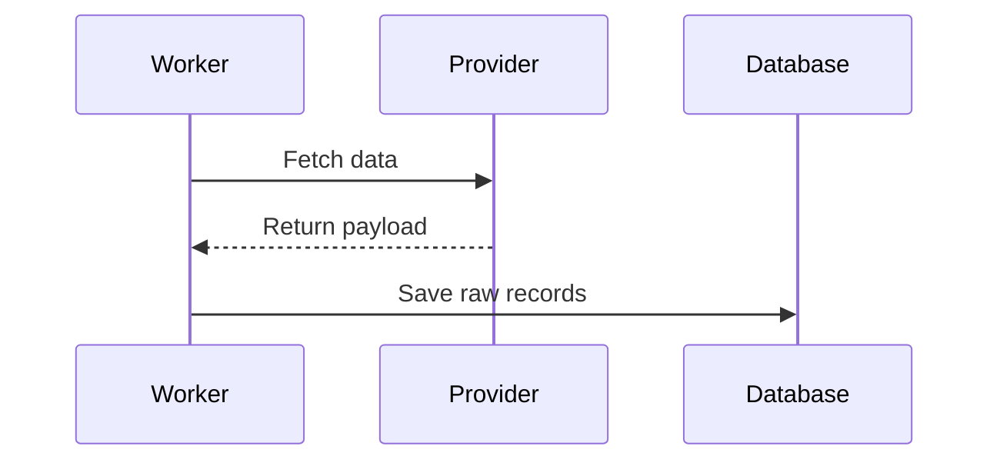

# A job, from schedule to storage

This proposal separates the technical queue from the ingestion use case.
The worker claims the next available job and forwards it to the registered handler.

## Admission and execution

The scheduler creates a durable job. The worker owns leases and retries; the ingestion handler owns provider calls and raw storage.

## One provider request

The provider response is retained before the worker acknowledges completion.

## Responsibility boundaries

| Component | Responsibility |
| --- | --- |
| Queue | Durable delivery, leases and retries |
| Ingestion | Provider protocol and source persistence |
| Reporting | Query accepted analytical outputs |

Select a passage, comment on a whole paragraph, or click a diagram element. Send your comments as one batch.
