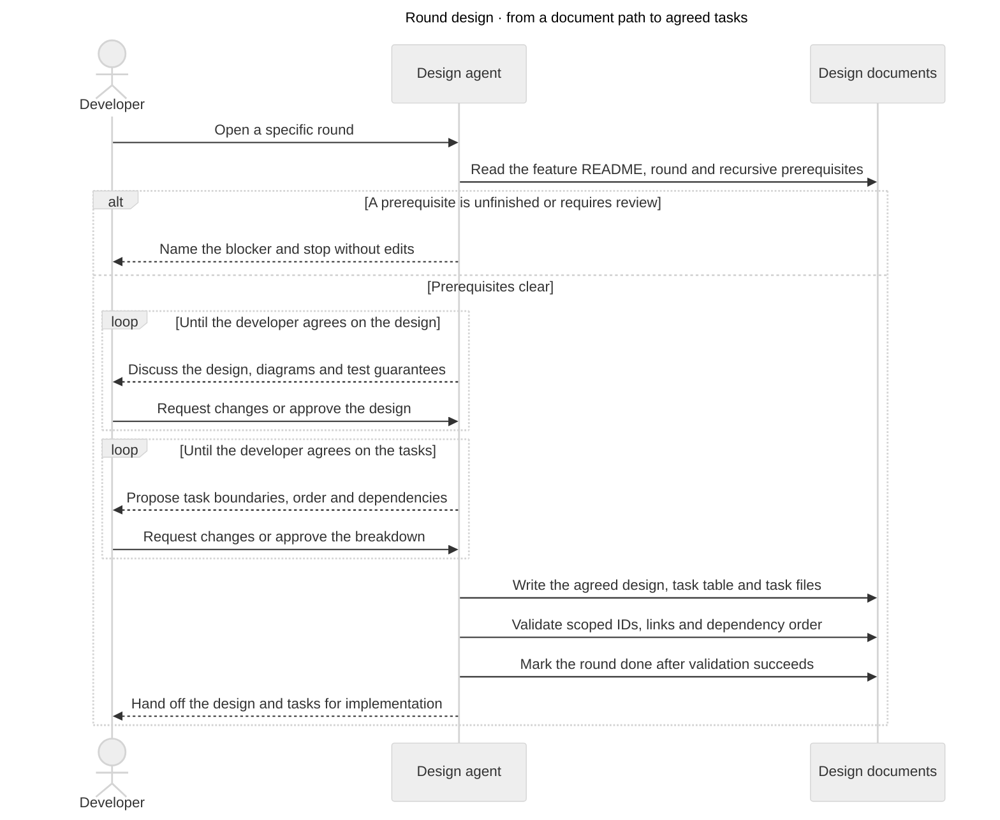

# Design one round

Input: a path to an existing round design document, for example
`docs/features/example/R2-provider-contract.md`. If missing or ambiguous, ask for the intended document.

Read [the shared artifact contract](artifact-contract.md) before changing documents.
It owns metadata, paths, statuses, task structure, refactor handling and dependency checks.

## Process at a glance

This sequence shows a leaf round. Grouped rounds instead plan/coordinate children using the nested-round contract.
It separates design agreement from task agreement before completion.

[Editable diagram](round-collaboration.mmd).

## 1. Load context and enforce prerequisites

Open the selected round in the [review app](review-app.md) as soon as its path is known. Opening a round leaves its design status unchanged.

Read repository instructions, the selected round's front matter, its linked feature README, and the shared refactor backlog.
For a nested/grouped round, first read [nested rounds](nested-rounds.md): load ancestor context and inherited prerequisites,
and distinguish group coordination from leaf design. Resolve `depends_on` recursively. Read prerequisite feature READMEs and designs in prerequisite-first order, deduplicating reads.
The agreed designs define intended contracts even when no corresponding implementation exists.

Every transitive prerequisite design must have `status: done` and no unresolved review flag before this round starts.
For missing/broken links, cycles, unfinished prerequisites or changed contracts awaiting review, stop this round's design.
Report the exact blocking paths and reasons. Do not edit its status/body, infer missing designs from code, or start prerequisites
automatically; let the developer choose which prerequisite to finish.
This gate is about completed DESIGN, not completed implementation tasks.

If the selected document is already done, summarize its agreements and ask what specifically should be reopened.
Preserve its content and task states until the developer authorizes that scope of revision.

Completion: required design context is loaded and every prerequisite is usable.

## 2. Design with the developer

For an existing group, review its shared agreements and child index rather than running the leaf/task workflow below.
If children remain unfinished, identify the next eligible child and stop for handoff; do not design all children automatically.
If every child is done, verify the group's own completion conditions in the nested-round contract and finalize it when satisfied.

If the round is too large for one focused human review, propose splitting it before detailed design/task decomposition.
Use [nested rounds](nested-rounds.md); agree the child boundaries and dependencies, scaffold their metadata, and stop for handoff.
Do not automatically design every child in the same session. Existing task-bearing rounds require an agreed migration before splitting.

Set the selected round to `in-progress`; update the feature index to match.
Restate the round's question and non-goals briefly. Use relevant repository engineering/testing guidance before technical design.
Inspect only the code needed to validate current seams, compatibility and constraints; do not rediscover decisions supplied
by the prerequisite designs. Label discrepancies between current implementation and agreed target architecture explicitly.

Use `mermaid-diagrams` for diagram selection and production, including its applicable companion production workflow.
Reuse already agreed audience, scope, model and renderer choices where applicable. If the required skill is unavailable,
report that limitation instead of claiming its workflow was followed.

Keep the conversation concise: one decision at a time, a small diagram when it helps, the main tradeoff and the properties
to test. Diagrams carry the structure; short prose explains their meaning. Avoid a single exhaustive design dump.
Use suitable component, flow, sequence, state or data-model views. Distinguish current, proposed and unresolved elements.

Keep the round document current: problem/scope, chosen design with Mermaid diagrams, relevant contracts/interfaces,
failure behavior, acceptance invariants and genuinely open decisions. Follow local ADR requirements for lasting decisions.
Discuss test seams and independent expected results alongside behavior; reuse exact existing proof before adding new proof.
Apply the artifact contract whenever a required or deferred refactor emerges. An unfinished new prerequisite blocks the
round: save the unresolved dependency, retain `in-progress`, and report the prerequisite rather than assuming its outcome.

Completion: the developer explicitly agrees the design and required interfaces/invariants; no blocking decision remains.
Existing explicit agreement counts. Silence, a dismissal or a preselected option does not.

## 3. Agree atomic tasks

Only after leaf design agreement, propose implementation tasks with stable IDs: `R2-T1`, or `R2.1-T1` for a nested leaf.
Propose `executor: human` or `executor: agent` for each task and agree assignments with the developer alongside its boundaries.
Each task owns one coherent, independently verifiable outcome, explicit interfaces and dependencies.
Split by responsibility and testable behavior, not arbitrary file count or an automatic backend/frontend/test sequence.
Tasks may depend on other rounds' tasks; avoid cycles and unnecessary ordering that hides possible parallel work.
Design completion does not satisfy implementation dependencies.

Iterate the decomposition with the developer: boundaries, scope, acceptance criteria and dependency edges.
A task's implementation agent must be able to follow its design links without guessing an unresolved interface.
Required refactoring tasks come before their dependent tasks; deferred backlog items do not enter this task graph.
If decomposition exposes a design gap, return to design discussion and obtain agreement on the changed contract first.

Completion: the developer explicitly agrees the task list, executor assignments and material dependencies. Then write the task files.

## 4. Materialize and finish

Create each agreed leaf task at `tasks/<round-id>-T<n>-<subject>.md`, relative to the feature README, using the artifact contract.
For example: `tasks/R2.1-T1-provider-adapter.md`. Group rounds index child rounds instead of duplicating their task files.
Each has metadata and concise sections for problem, solution with a focused Mermaid diagram, acceptance criteria,
main interfaces to add/change, and definition of done. Link shared design rules; avoid copying the whole design.
State task ownership and observable outcomes without inventing precise APIs the design has not agreed.
Task files start `not-started`; this skill does not implement them or update implementation status.

List the tasks in a table in the leaf design: ID/link, outcome, executor, dependencies and status.
Keep the agreed dependency links authoritative in task front matter; the table mirrors them.
Verify all schemas/links, graph acyclicity, ID uniqueness, diagrams and task coverage against the agreed design.
Missing task dependencies must be materialized by their owning design before finalization, not guessed or silently ignored.

Set the round's status to `done` only after BOTH design and tasks are agreed, files exist, and verification passes.
Update its README row and any parent sub-round table. `done` means design and decomposition complete, not implementation complete.
Group completion additionally follows the nested-round contract; finishing one child does not finish its parent.
For a deliberately task-free round, record the developer's explicit agreement and rationale instead of creating empty tasks.

When upstream contracts change, follow the artifact contract's review propagation; preserve existing task implementation states.
Finish with links to the round and task table, remaining blockers and verification results. Keep it short.
No application code, tests, commits or external publication are authorized by this skill alone.
