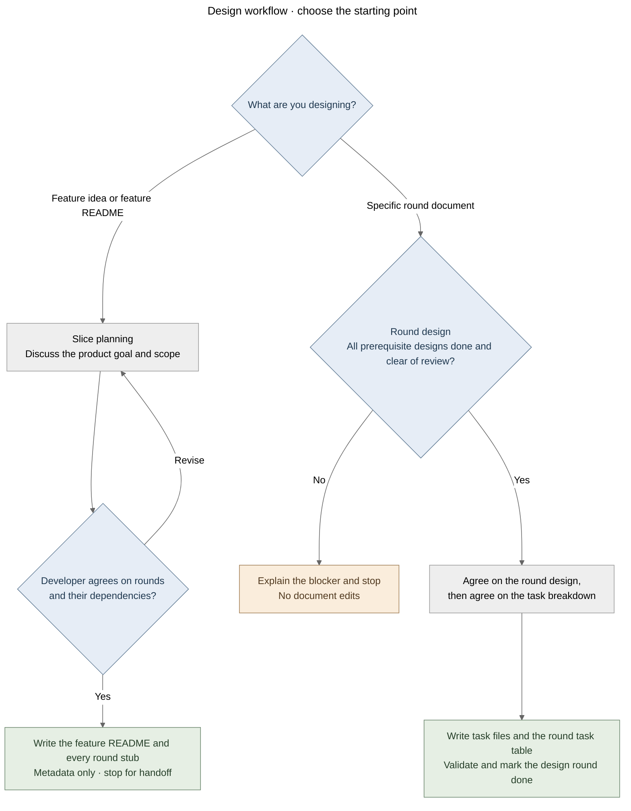

# Plan a feature slice

Turn a feature idea into a small, agreed map of design rounds. This skill creates design documents, not implementation.

Read [the artifact contract](artifact-contract.md) before writing documents. It owns schemas, links, statuses,
refactor handling and completion checks shared with the round-design workflow.

## Process at a glance

This overview shows the two entry points and the handoff boundaries.

[Editable diagram](process-overview.mmd).

## 1. Establish the feature

Open the feature README or initial idea draft in the [review app](review-app.md) before discussing the feature.

Read repository instructions and any existing feature README. Check the repository's shared refactor backlog for relevant
entries using the artifact contract. Inspect enough project/domain documentation to identify current ownership and constraints.
Distinguish implemented behavior from intended behavior in existing design documents.

Discuss the user, problem, valuable outcome, high-level requirements, scope and non-goals with the developer.
Ask short, focused questions only for unresolved product decisions; reuse agreements already present in the conversation.
Keep detailed behaviors, interface design and error matrices for the owning design round.

Completion: the developer has explicitly agreed the feature's high-level intent and boundaries.
If that agreement already exists, proceed without asking for it again.

## 2. Agree the rounds

Propose focused rounds around reviewable mechanisms, contracts or decisions, with their direct prerequisites.
Round count and boundaries follow the feature; rounds are not automatically packages or one-to-one implementation tasks.
Use nested sub-rounds only when they improve human review; load [nested rounds](nested-rounds.md) for that case.
Prefer the thinnest valuable delivery path. Testing belongs in every round; a fixture/parity round is useful only when it
owns a distinct evidence problem, not as a reason to postpone tests until implementation ends.

Present a short table: ID, purpose, dependency and expected decision. Explain blocking refactors separately from later work.
Follow the artifact contract when a refactor needs a prerequisite round or a deferred backlog entry.
Use `mermaid-diagrams` if a small overview will clarify the proposed boundaries or dependencies.

Completion: the developer agrees the round decomposition and dependency order. Preserve IDs once documents are referenced;
subsequent reordering changes links and index presentation, not existing IDs.

## 3. Scaffold the agreed feature

Use the repository's feature-document location; default to `docs/features/<feature-slug>/`.
Create or update its `README.md` with:

- One short product paragraph, high-level requirements and non-goals.
- The round table with Markdown links to every round, descriptions, dependencies and current status.
- Required prerequisites and links to relevant shared backlog entries, with timing/triggers.
- A brief next step pointing to the first eligible round.

Create ALL agreed `R<n>-<subject>.md` files. A new round file contains YAML front matter only:
`id`, `status: not-started`, `feature`, `depends_on` and a short `description`, exactly as the artifact contract specifies.
For agreed nesting, include the reciprocal `parent_round`/`sub_rounds` metadata described in the nested-round contract.
Create no headings, proposed solutions or task files inside those round stubs.

If a repository documentation index exists, add a concise feature link in its appropriate section.
On re-entry, preserve existing design bodies, task files and statuses; add only newly agreed rounds or scoped updates.
Scaffolding a feature does not start its first design round automatically.

## 4. Verify and hand off

Check metadata, relative wiki-link resolution, graph acyclicity, unique stable IDs and index consistency using the artifact contract.
New rounds can depend on other not-started stubs; actually designing them is gated by the round-design workflow.
Check required and deferred refactors are represented once, with no deferred implementation tasks accidentally added.
Report the README link and which round can start next. Mention unresolved product decisions rather than inventing them.
No application code, tests, commits or external publication are authorized by this design skill alone.
